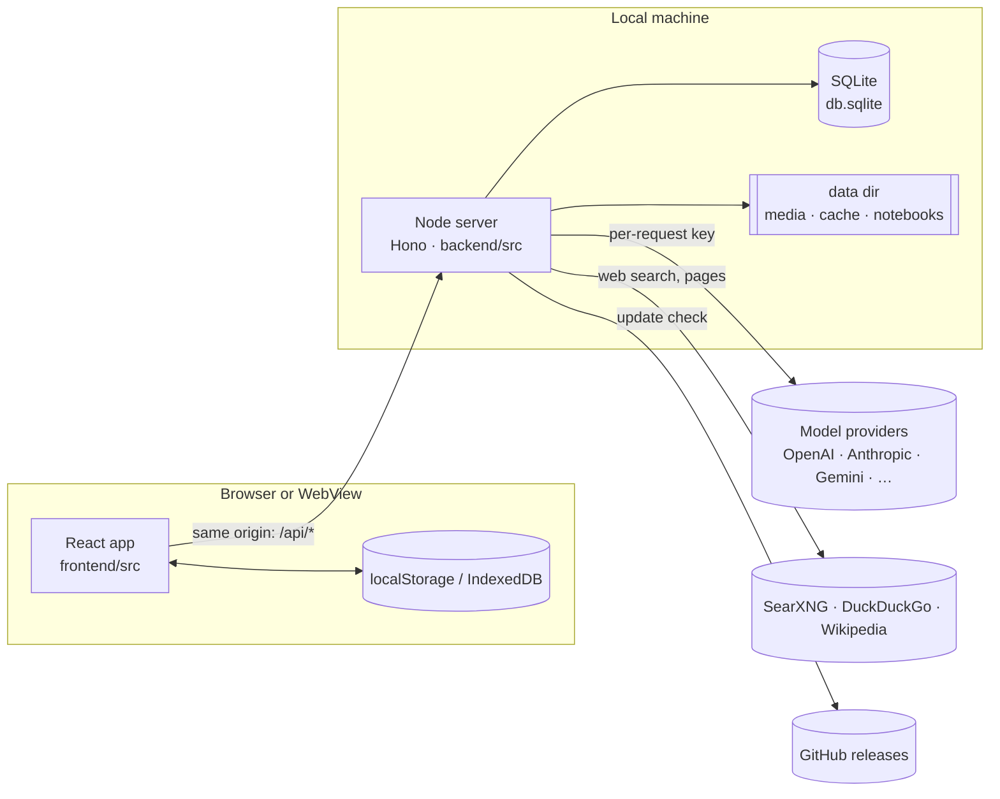
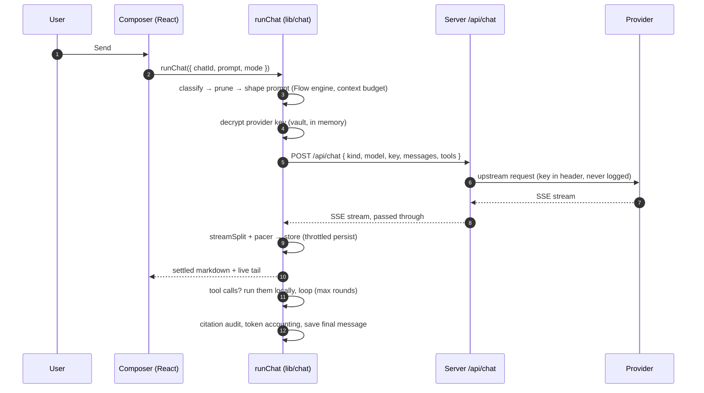
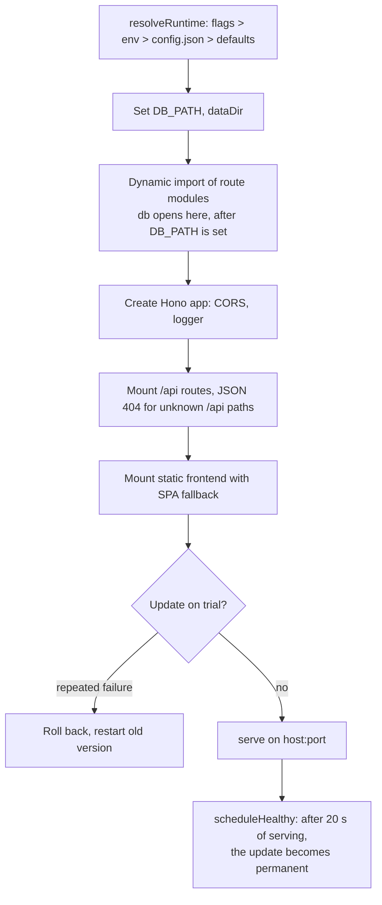
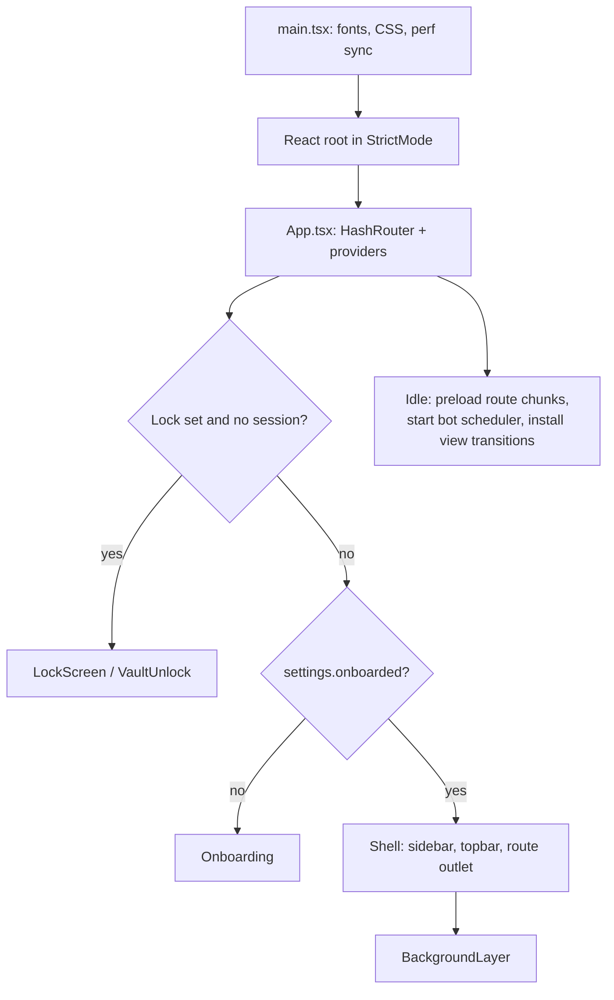

# 3. Architecture

## Process topology

Research Engine has one server process in every run mode. The difference between
modes is who starts it and whether the UI is bundled with it.

| Mode | How it starts | Who serves the UI |
|---|---|---|
| **Single process** (`npm start`, the binary, Docker) | `node backend/bin/research-engine.mjs serve --port 3847` | The server serves `frontend/dist` from the same origin |
| **Desktop app** | The Tauri shell starts the bundled sidecar, or reuses a server already on `127.0.0.1:3847` | The shell's window loads `http://127.0.0.1:3847/` |
| **Development** (`npm run dev`) | `scripts/dev.mjs` starts `tsx watch` on the backend and Vite on the frontend | Vite on `:5173`, proxying `/api` to the backend on `:8787` |
| **Website** | Static files | No server |

The frontend never talks to a third-party API directly, with one exception: the
browser `fetch` to the model provider is replaced by a call to `/api/chat`, which
relays the stream. This is because several providers do not allow browser CORS
requests. The rule is stated in `backend/src/routes/chat.ts`.

## Request path

A typical request, a chat message with a streamed answer:

Two properties of this path matter to every change:

1. **Keys travel with the request and nowhere else.** They are decrypted in
   memory, sent in the body or a header, and dropped. The server's log middleware
   records method and path only.
2. **Tools run in the browser.** When the model asks for a tool (read a file,
   search the Library, run a coding command), the call is executed by the
   frontend in `lib/chat/tools.ts` or by a backend route it calls. The model
   never gets direct access to the machine.

## Startup

### Backend (`backend/src/index.ts`)

The order is deliberate. Route modules are imported *after* `resolveRuntime`,
because `db/index.ts` opens its database at import time, and `DB_PATH` is only
known once the data directory is resolved. A static import at the top of
`index.ts` once opened the database in the working directory instead of the
user's library. Keep that rule in mind when you add a route.

Port selection: the preferred port is `--port`, else `RE_PORT` or `PORT`, else a
remembered port from `config.json`, else `3847` (built bundles) or `8787`
(running from source with `tsx`). If the port is busy, the next free port is
used and remembered.

### Frontend (`frontend/src/main.tsx`, `App.tsx`)

`App.tsx` renders the overlays that are not on screen at first paint (settings
sheet, command palette, shortcuts, skill builder, onboarding) as lazy components,
so they do not weigh on the entry bundle.

## Layers

| Layer | Responsibility | Examples |
|---|---|---|
| **Presentation** (`frontend/src/components`) | Renders state, dispatches actions. Holds no business rules. | `ChatView`, `LibraryView`, `BotsView` |
| **Application logic** (`frontend/src/lib`) | Pure rules where possible, plus clients for server routes. Testable in Node. | `lib/chat/runChat.ts`, `lib/bots/logic.ts`, `lib/learn/cards.ts` |
| **State** (`frontend/src/stores`, `lib/storage`) | Zustand stores, persisted in batches. | `useStore`, `useUI`, `useDesign` |
| **Server routes** (`backend/src/routes`) | Thin HTTP adapters: parse, validate, call a service, respond. | `routes/chat.ts`, `routes/library.ts` |
| **Server services** (`backend/src/services`) | The work behind the routes. | `services/rag.ts`, `services/search/adapters.ts` |
| **Persistence** (`backend/src/db`) | Three engines behind one interface. | better-sqlite3, `node:sqlite`, memory |

Many `lib` modules are written so that their rules can be tested with `tsx` in
Node, without a DOM. Where a module needs the browser (`localStorage`, `window`),
the test scripts install a small stand-in first. See [testing](12-testing.md).

## Concurrency and resource model

- **Streams are capped per profile.** `concurrentStreams` is 1, 2 or 4 for
  `eco`, `balanced` and `performance`. `floodWorkers` (parallel agents) follows the
  same ladder.
- **Background work is switched off in eco.** `backgroundIndexing` is `false` in
  eco. In eco, animated backgrounds fall back to a static CSS gradient and the
  frame-budget monitor can lower quality further.
- **The backend owns its child processes.** Preview dev servers started for coding
  projects are stopped when the backend exits. Caches keyed by user input use
  `BoundedMap` (`backend/src/services/boundedMap.ts`), so they cannot grow without bound.
- **Persistence is throttled.** The main store writes at most every 400 ms, which
  matters because streaming changes state dozens of times a second.

## Where the rules live

When you are unsure where a behaviour is decided, look in this order:

1. The module's header comment. These are long and specific, and they record why.
2. `frontend/src/lib/chat/runChat.ts` for anything about a turn.
3. `backend/src/runtime.ts` for anything about startup, ports and profiles.
4. `backend/src/update/service.ts` for anything about updates.
