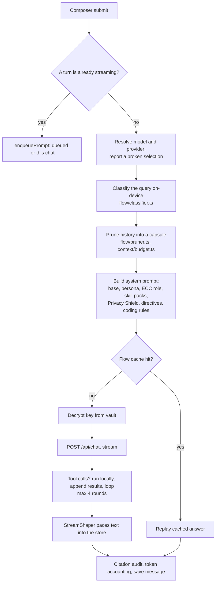

# 6. Chat engine

This chapter follows one message from the composer to a saved answer. It covers
the pipeline in `frontend/src/lib/chat/runChat.ts`, the Flow engine that shapes
context and streaming, the tools the model can call, and the limits that keep a
long session from growing without bound.

## The send pipeline

`runChat(opts)` is the send function. The steps, in the order the code runs them:

Stage labels shown to the person come from the Flow engine's `FlowStage`:
`understand`, `search`, `read-sources`, `retrieve`, `think`, `compose`, `done`.
`ChatView` reads the current stage from `useUI.flow`, which drives the thinking indicator.

### Concurrency inside a chat

Each chat can have one streaming turn. Prompts sent while a turn is running are
put in a per-chat queue (`enqueuePrompt`) and run in order. A stopped turn uses an
`AbortController` (`stopStream(chatId)`), and it keeps whatever text was already
rendered. The citation audit runs on that partial text.

### Routing a request

`runChat` picks a provider from the selected model. Every provider has a *kind*
that decides the wire format (`providers/registry.ts`):

| Kind | Used by | Wire format |
|---|---|---|
| `openai` | OpenAI, and most OpenAI-style hosts such as Groq, DeepSeek and LM Studio | Chat completions |
| `anthropic` | Anthropic | Messages API |
| `gemini` | Google Gemini | `generateContent` |
| `ollama` | Local Ollama | Ollama API |
| `compatible` | Other OpenAI-style gateways | Chat completions |
| `decision` | Jev (TypeSafe AI) | Typed decision requests, not chat |

Jev is not a chat model. It answers typed questions with probabilities. It is
routed as a separate kind so the chat path does not try to treat it as text.

If no key is set, or the selected model is `demo`, the turn runs on the on-device
demo model (`providers/demo.ts`). The UI labels the answer as demo.

## The Flow engine

`AIFlowEngine` is in `frontend/src/lib/flow/`. It has three jobs. Each job is a
separate module.

### 1. Classify (`classifier.ts`)

Regular expressions and simple intent heuristics assign each query one of six
classes: `factual`, `reasoning`, `math`, `code`, `creative`, `longform`. No API call
is made. The class selects the prompt master and the work mode. Math queries get
step-by-step LaTeX guidance, for example.

### 2. Prune context (`pruner.ts`, `context/budget.ts`)

Older messages are folded into a **capsule**: a compact summary of decisions,
constraints, names and code, assembled from the messages themselves. The capsule
ends by telling the model that it is the whole history. The full history stays
in the browser; only the capsule is sent.

Pruning is adaptive. If a capsule would not actually reduce the token count, the
full context is sent instead. The history budget depends on the effort setting:

| Effort | History budget (estimated tokens) |
|---|---|
| `efficient` | 12,000 |
| `balanced` | 32,000 |
| `fidelity` | 96,000 |

Other caps in `context/budget.ts` apply to every piece that reaches a model:
verbatim text, tool results, skill packs and attachments. Older tool output is
compacted first. The newest turns and the active question are never cut.

Fork (`chat/fork.ts`) uses the same capsule idea. A forked chat starts with a
capsule of the original, not a copy of every byte, and the capsule has a token
ceiling. Given the same messages and options, the same capsule is produced.

### 3. Cache (`cache.ts`)

Answers are cached in `localStorage` under a normalised form of the query. The
cache holds the 120 most recent entries. A hit is replayed at zero cost, with
the same stream shape, and is recorded in the message's Flow stats.

### 4. Pace the stream (`engine.ts`)

Providers send text in uneven bursts. The `StreamShaper` turns them into a steady
cadence:

- It measures the arrival rate over a 500 ms window.
- A buffer that runs dry for 250 ms is treated as a stall. The display waits
  rather than jumping.
- When the buffer holds more than 40 words, the shaper speeds up, but the gap
  between words never drops below 10 ms, so text is never dumped at once.
- The shaping mode (`off`, `subtle`, `standard`, `cinematic`) and the thinking
  style (`minimal`, `standard`, `verbose`) are settings.

`flowDiagnostics` keeps a short sample of arrival and render times for the
Performance panel.

## Streaming, thinking and rendering

- **Settled and live text.** `streamSplit.ts` divides the answer into settled
  Markdown and a live tail (see [frontend](05-frontend.md#streaming-text-in-the-ui)).
- **Chain of thought.** `thinking-phases.ts` separates a model's reasoning into
  phases (reasoning, questioning, committing) rather than showing one block. The
  thinking display streams while the model thinks, and folds away when the answer
  text starts.
- **Markdown dialects.** `markdownDialects.ts` normalises each provider's citation
  and maths syntax before rendering. A ChatGPT `【3†source】` marker becomes a
  normal source reference.

## Sources and the citation audit

When search is on, the web results are added as sources. Each source carries a
title, a URL, a domain and the snippet used. The answer's `[n]` markers point at
those sources.

After the answer is complete, `lib/rag/audit.ts` checks every `[n]` against the
set that was actually retrieved. A marker that points outside the set is flagged,
because a model can write a plausible-looking citation for a source it never
saw. This is the fix for the most common failure of AI search answers.

The server side of retrieval is `backend/src/services/rag.ts`. It parses the query,
plans sub-queries, retrieves, ranks, and fuses the results into one context block.
The client gets a grounded block, not raw snippets.

## Modes

The composer offers these modes. Each is a set of prompt and pipeline choices:

| Mode | Behaviour |
|---|---|
| **Flow** | Default. Uses the Flow engine with the effort-based budget. |
| **Search** | Web search with citations. Cmd/Ctrl+Enter sends in this mode. |
| **Quality** | Longer, cited answers. |
| **Math** | Step-by-step reasoning in LaTeX. |
| **Replicate** | Staged research plan: source discovery, principle extraction, mechanism, replication guide, anti-patterns, primary-source pointers. Each stage is shown. |

Privacy Shield's *Top Secret* posture disables the web entirely. `prepareRag`
checks the posture before any retrieval happens.

## Tools

The model may call tools. The tool definitions are in `lib/chat/tools.ts`
(`TOOLS` and `toolSpecs()`). Tool results return to the conversation, and the
loop runs at most **4 rounds** per turn (`MAX_TOOL_ROUNDS`).

The tools, grouped:

| Group | Tools |
|---|---|
| Interaction | `ask_user`, `open_section`, `show_tooltip_card`, `start_coding_mode` |
| Research | `web_search`, `docs_search`, `library_search`, `library_read`, `read_local_file`, `list_local_files` |
| Connectors | `connector_search`, `connector_read`, `integration_search`, `integration_read` |
| Composio | `composio_apps`, `composio_tools`, `composio_run` |
| Business services | `seo_domain`, `seo_keywords`, `crm_search`, `crm_create`, `social_channels`, `social_draft` |
| Voice | `voice_speak` |
| Coding (project open) | `ide_list_files`, `ide_read_file`, `ide_write_file`, `ide_run_command`, `ide_git`, `run_ui_test`, `session_sandbox` |
| Design | `design_preview`, `design_navigate`, `design_snapshot`, `design_inspect`, `design_click`, `design_type`, `design_resize`, `design_screenshot`, `design_assert`, `design_console`, `design_audit`, `design_controls` |
| MCP | `mcp_call` |

Two rules apply to all tools:

- **Destructive actions need the person.** Writes outside the project, commands
  on the confirm list, and clones all return `requiresConfirm` and wait for the UI.
  `resolveExec` and `submitQuestionnaire` carry the answer back.
- **Parallel agents get their own copy.** When `ToolContext.agentId` is set, file
  and command tools work inside that agent's worktree, not the shared folder.

Bots use a different, text-based grammar (`lib/bots/logic.ts`), described in
[feature areas](07-feature-areas.md#bots). It is not the tool-call API.

## Cost and budget guards

Every real provider call is counted. Three mechanisms keep a long session or a
runaway loop from growing without bound:

1. **Daily token budget** (`lib/usage/guard.ts`). Real tokens are counted per
   local calendar day. New real requests stop when the day's budget is spent.
   The default is 2,000,000 tokens. The choices are 0 (no limit), 1, 2, 5 and
   10 million. The on-device engine is free and is never counted.
2. **Context caps** (`lib/context/budget.ts`, described above).
3. **Tool-round and step caps.** Four tool rounds per turn; three tool steps per
   bot reply (`MAX_TOOL_STEPS`); two ECC roles per reply (`MAX_ROLES_PER_REPLY`).

Token accounting is honest about what it knows. Some providers report counts;
some do not. Totals are marked *reported* when the provider gave them and
*estimated* otherwise. Every response carries its cost, whether or not the Flow
engine is on.

The context-window meter in the top bar uses `providers/context-window.ts`. Providers
do not report window sizes over their APIs, so this is a family lookup with an
honest default. The UI says the number is approximate.

## Humanize

`lib/chat/humanize.ts` rewrites an answer to read more naturally. It runs through
the same configured provider, with the same key handling and the same connection
log as a normal turn. The rewritten text streams into the existing message.

## Where to change things

| You want to… | Look at |
|---|---|
| Change how a turn is assembled | `lib/chat/runChat.ts` (search for the stage comments) |
| Change the prompt for a query class | `lib/prompts/masters.ts`, `lib/prompts/workModes.ts` |
| Add a tool | `lib/chat/tools.ts` (`TOOLS`), then `services/` or a route for its server side |
| Change streaming feel | `lib/flow/engine.ts` (`StreamShaper` constants) |
| Change what is kept in context | `lib/context/budget.ts`, `lib/flow/pruner.ts` |
| Add a provider | `lib/providers/registry.ts`, `stream.ts`, `key-guides.ts`, and the backend dialect in `routes/chat.ts` |
